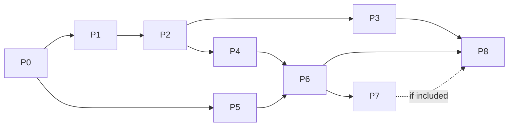

# CodeMind: Change Analysis, Explanation and Safe Testing

**Created:** 2026-11-25  
**Status:** P1 qualified for administrator-assisted macOS/APFS capture; P2 complete within documented static JS/TS library scope; P3 deterministic workflow qualified; P4 static planning qualified; P5 isolation boundary implemented and locally qualified; P6 complete within the bounded native Node / exact flat public-registry dependency adapter; P7 complete within qualified Node/Vitest compatibility matrix; P8 not started
**Purpose:** Execution checklist for the owner-provided proposal and the repository-based architecture review.

A task is complete only when its implementation and required verification are complete. The original planning review was source-only. Phase 1 implementation and verification are recorded below and in `change_analysis/PHASE1.md`. Preserve existing local changes.

## 1. Product objective and responsibilities

A developer saves changes, clicks **Analyze Change**, understands the relevant before/after flow, reviews proposed checks, and optionally executes selected supported tests in an isolated environment.

Build one coordinated workflow with shared evidence and a separately isolated runner. The three agents describe bounded software responsibilities; they do not require three autonomous LLM systems.

| Component | Responsibility | Must not do |
| --- | --- | --- |
| Understanding | Capture saved changes and establish facts, relationships, impact and uncertainty | Invent runtime behavior or mix source versions |
| Explanation | Teach using validated evidence and deterministic templates | Create graph facts or hide uncertainty |
| Testing planner | Discover related tests and propose evidence-backed scenarios | Treat static association as coverage or invent expected behavior |
| Runner | Execute exact authorized checks under enforced isolation | Execute arbitrary model commands or write into developer source |
| Result classifier | Report observations and supported change attribution | Treat every failed command as a newly introduced bug |

The product must distinguish what source shows, what relationships establish, what is inferred, what a test observed, whether the change caused it, and what remains unverified.

## 2. Current project integration points

These are findings from the 2026-11-25 source review. Revalidate before implementation.

| Existing file/component | Reuse | Required extension |
| --- | --- | --- |
| `extension/src/extension.ts` | Selection, commands, watchers and refresh | Dedicated controller and stale-result lifecycle |
| `extension/src/serverManager.ts` | Authenticated engine calls | Typed analysis and test-run client methods |
| `ai-engine/api.py` | Local API and session infrastructure | Versioned change routes without replacing `/ask` |
| `knowledge_base/synchronization.py` | Immutable knowledge generations, freshness, reader protection | Distinct captured source state and matching logic |
| `knowledge_base/storage.py` | Repository-local storage and containment | Bounded session artifacts and lifecycle integration |
| `knowledge_base/scanner.py` | Inventory, exclusions and hashes | Capture-safe inventory and test metadata support |
| `knowledge_base/semantic_resolver.cjs` | JS/TS symbols and relationships | Both-version analysis and supported framework adapters |
| `knowledge_base/identity.py` | Canonical identities | Separate before/after correspondence |
| `query_system/evidence_contracts.py` | EvidencePackage and integrity checks | Wrapper around separate version-specific packages |
| `query_system/execution_contracts.py` | Bounded analysis operations | Reuse concepts; separate repository-program execution |
| `query_system/rule_registry.py` | Test-reference limitations | Preserve distinction between references and coverage |

Important constraints:

- `SnapshotStore.changed_files` compares index generations, not the entire saved diff against HEAD.
- Existing `EvidencePackage` validates one snapshot identity. Before/after evidence needs a wrapper, not mixed records.
- Symbol identity includes attributes that change during renames/signature edits. Identity equality is insufficient for correspondence.
- The API's Git porcelain-based dirty fingerprint is not a content hash.
- The locked README conflicts with this proposal and parts of the current implementation. Reconcile scope and architecture in Phase 0 before implementing feature code under the updated contract.
- Saving this plan does not implement the proposal or establish that existing release gates pass.

## 3. Scope of the first release

### Included

- One selected local Git repository at a time.
- Saved `.js`, `.jsx`, `.ts`, `.tsx`, `.mjs`, `.cjs`, `.mts`, `.cts` files.
- Tracked changes and eligible, non-ignored untracked files.
- Direct calls, imports, exports and bounded caller relationships.
- Focused textual before/after flow.
- Deterministic explanations and scenario planning without an LLM.
- Optional local-model wording improvements.
- Node test runner first; Vitest through a separately qualified adapter.
- Planning remains available when execution is unsupported.
- Existing supported tests before narrow temporary-test templates.

### Deferred

- Arbitrary package scripts and broad Jest compatibility.
- Playwright/browser execution and multi-service integration environments.
- General monorepo orchestration.
- Arbitrary LLM-generated test programs.
- Python execution adapters.
- Automatic fixes or adding tests to developer source.
- Cloud/team deployment and distributed agent infrastructure.

JS/TS syntax support does not imply understanding every framework. Express routes and similar behaviors require explicit adapters. String matching does not prove a UI action reaches a backend.

## 4. Corrections to the original proposal

| Original concept | Required correction |
| --- | --- |
| Saved workspace against HEAD | Define staging, untracked, unsaved and exclusion semantics |
| One evidence package | Wrap separate before/after packages |
| Verified flow graph | Separate structural facts, inferred flows and runtime observations |
| Tests protect the change | Distinguish association, runtime reach, assertions and regression evidence |
| Missing coverage | Say “No matching test found within analyzed scope” unless stronger proof exists |
| Expected behavior | Require an expectation source |
| Reproduced failure | Separate setup failure, assertion failure, pre-existing failure and regression |
| Temporary directory is safe | Require an enforced execution boundary |
| Allowlisted command is safe | Treat scripts, configuration, plugins and dependencies as untrusted code |
| Remove all secrets | Minimize exposure; filtering cannot detect arbitrary embedded secrets |
| One cache key | Include tools, policies, dependencies and configuration identities |
| New save invalidates everything | Mark old results stale for current workspace while preserving historical provenance |
| No planner rescan | Shared inventory, incremental test catalog and bounded extra inspection |
| Immutable execution workspace | Immutable source capture plus disposable writable materialization |

## 5. Capture policy

| Situation | Required behavior |
| --- | --- |
| Baseline | HEAD captured when analysis starts |
| Tracked files | Compare final saved working-tree bytes with HEAD |
| Staged and unstaged edits | Analyze final saved contents; show staging metadata separately |
| Untracked files | Include eligible files and report exclusions |
| Unsaved buffers | Exclude with visible notice |
| Deleted files | Preserve baseline evidence and removed relationships |
| Renames | Track correspondence; label ambiguity |
| Binary/oversized files | List as unanalyzed changes |
| Merge conflicts | Identify conflicts and block definitive analysis |
| No initial commit | Explicit all-files-added mode |
| Non-Git folder | Unsupported for initial HEAD comparison |
| Submodules | Report reference change without recursive analysis |
| Symlinks | Initially exclude symlinked source; reject escaping paths |
| Nested project/larger Git root | Explicit repository boundary and path scope |

Capture sequence:

1. Resolve and validate repository boundary.
2. Capture HEAD and eligible inventory.
3. Read saved bytes into a private capture.
4. Record hashes, exclusions and diff metadata.
5. Recheck HEAD and source consistency.
6. Publish only a consistent capture.
7. Retry a bounded number of times, then report changing files rather than mixed evidence.

Do not checkout HEAD in the developer workspace. Use controlled Git object access and disable external diff helpers, text conversion and optional execution hooks where applicable. Git status text is not content identity.

## 6. Three different snapshots

| Snapshot | Purpose |
| --- | --- |
| Source capture | Exact immutable saved bytes being analyzed |
| Knowledge snapshot | Parsed symbols, graph, search records and evidence |
| Execution workspace | Disposable writable copy/overlay for selected tests |

Reuse a knowledge generation only when its manifest matches the capture; otherwise derive structural data from captured files. Structural analysis must not wait for embeddings. Preserve reader/freshness protections but do not hold index locks during LLM calls or tests. Never hard-link execution files to developer files.

## 7. Versioned contracts and certainty

| Contract | Required information |
| --- | --- |
| `ChangeSnapshot` | Repository, HEAD, saved manifest, exclusions, digest, capture time |
| `ChangeEvidencePackage` | Before/after packages, symbol mapping, changed relationships, limitations, adapter versions |
| `TestProfile` | Framework/runtime, dependency identity, command descriptors, environment policy, limits |
| `TestPlan` | Scenarios, evidence, expectation sources, related tests, unknowns, proposed checks |
| `RunAuthorization` | Capture, plan, profile, selected checks, temporary-test hashes, policy digest |
| `TestRun` | State, environment, command, test counts, outcomes, artifacts, termination reason |

Validation invariants:

- Every source reference belongs to a specific version.
- Every graph edge has validated nodes and relationship evidence.
- Symbol correspondence may have zero, one or multiple candidates; ambiguity remains visible.
- Validate repository/capture ownership at every boundary.
- Changed commands, temporary tests, profiles or policies invalidate authorization.
- Every truncation records reason and affected scope.
- Preserve existing EvidencePackage integrity checks initially.

Use independent dimensions, not one confidence percentage:

| Dimension | Values |
| --- | --- |
| Evidence basis | Source-verified, relationship-verified, inferred, unresolved |
| Execution | Passed, assertion-failed, setup-failed, timed-out, cancelled, not-run |
| Attribution | Introduced, pre-existing, inconclusive |
| Completeness | Complete within supported scope, partial, unsupported |

## 8. Impact analysis and explanation

For each changed symbol:

1. Map diff ranges to declarations.
2. Compare definitions and map correspondence.
3. Identify added, removed and changed relationships.
4. Traverse bounded callers/callees.
5. Connect supported routes and test metadata.
6. Record unresolved boundaries and omissions.

Correspondence uses exact identity where possible, enclosing scope/declaration location, rename metadata and structural similarity. Multiple plausible matches remain ambiguous.

Proposed initial budgets: depth 2, 100 displayed symbols, 200 displayed relationships, stable ordering, cycle detection and explicit omitted counts. Validate through benchmarks.

“loginRoute calls validateToken” may be structurally verified. “Invalid tokens reach this branch” requires control-flow evidence or an inference label.

LLM output uses validated evidence IDs and cannot add graph facts or commands. Validate schema and ownership; citations alone do not establish semantic truth. Reject unsupported claims or use deterministic fallback. Treat repository text as untrusted prompt content. Presentation variants reuse evidence.

## 9. Test planning and coverage evidence

| Level | Permitted statement |
| --- | --- |
| Name/filename association | This test may be relevant |
| Resolved import/call | This test references changed code |
| Exact-run runtime coverage | This execution reached these lines/branches |
| Relevant assertion | This assertion checks this expected outcome |
| Comparable baseline/current runs | This check passes before and fails after |

Line coverage alone does not prove a meaningful assertion. Reuse shared inventory, maintain an incremental test catalog, and permit bounded inspection of captured test source. Do not create another full repository-understanding pipeline.

Each scenario records:

- Scenario and changed behavior/relationship.
- Evidence references.
- Preconditions and fixtures.
- Expected outcome and its source.
- Related tests and relationship strength.
- Required adapter/environment.
- Eligibility and remaining uncertainty.

Expected behavior comes from existing assertions, explicit contracts, validated specifications or user-confirmed requirements. If unknown, ask for intended behavior before treating the scenario as a defect check. Do not invent HTTP status codes or business rules.

## 10. Safe execution and dependency preparation

### Enforced execution boundary

- Narrow runner broker separate from analysis.
- Pinned runner image in a supported Linux VM/container environment.
- No direct host-process fallback.
- No privileged execution or runtime socket inside the sandbox.
- No developer repository, home directory, SSH agent or credential mounts.
- Minimal environment containing synthetic test values only.
- No external network route during runs.
- Writable locations limited to disposable workspace/output.
- Explicit CPU, memory, process, disk, time and output limits.
- Process-tree termination and cleanup.
- Workspace Trust as an additional user-intent gate, not isolation.
- Same-sandbox loopback services only initially; no host port publishing.
- Unsupported sandbox means planning-only mode.

Scoped guarantee: supported runs receive no host credentials or host services, have no external network route, and cannot write to developer source through exposed mounts. Secret filtering is defense in depth; arbitrary secrets embedded in source cannot be perfectly detected.

Node permissions alone are not a security boundary against malicious code. Container resource limits require explicit configuration and qualification.

### Dependencies

Separate **Prepare test environment** from **Run selected checks**. Network-enabled preparation needs its own reviewed policy and authorization; ordinary runs remain offline.

- Require a supported lockfile.
- Pin runtime and package-manager versions.
- Prepare dependencies in isolation.
- Disable lifecycle scripts initially.
- Report unsupported native builds/install hooks explicitly.
- Never mount developer node_modules or use developer package credentials.
- Key artifacts by lockfile, platform, runtime and preparation policy.
- Prevent runs from modifying shared dependency artifacts.
- Use adapter-owned validated argument arrays, not model/webview shell strings.

Discovery of `npm test` does not authorize execution. Framework configuration, setup hooks and plugins can execute arbitrary code.

## 11. Results and attribution

| Result | Meaning |
| --- | --- |
| Selected tests passed | Structured adapter report confirms actual tests ran and passed |
| Assertion failure observed | Assertion failed in captured environment |
| Regression reproduced | Comparable check passed on baseline and failed after |
| Pre-existing failure | Comparable baseline also failed |
| Environment/setup failure | Dependency/configuration/fixture/service startup failed |
| No matching test found | No match within declared discovery scope |
| Potential risk | Source-backed concern not demonstrated |
| Could not verify | Required capability/environment unavailable |
| Inconclusive | Inconsistent or insufficient observations |

Rules:

- Zero tests is never a pass.
- Exit code alone is insufficient; parse supported runner reports.
- Generated tests may contain incorrect expectations; failure is not automatically a product defect.
- Retry success does not erase a preceding failure.
- Baseline comparisons record dependency/environment differences.
- Passing selected checks never means the change is universally safe.
- Show exact temporary tests before authorization; start with narrow templates.

Reports include versioned evidence, command/scenario, expectation source, expected/actual behavior, sanitized bounded logs, limitations and next step.

## 12. Lifecycle, APIs and authorization

Workflow: capture → analyze → explain/plan → review → authorize exact checks → prepare/run → report.

Job states: `queued → preparing → running → completed`, with `failed`, `cancelled` and `timed_out` alternatives. Keep `stale_for_workspace` separate from execution state.

Every job needs an ID, repository/capture identity, stage, cancellation token, budgets, timestamps, structured errors, idempotency key and artifact references.

On save:

- Mark prior analysis stale for current workspace.
- Cancel queued old-capture execution.
- Request cancellation of active old-capture runs by default.
- Preserve produced results with original provenance.
- Require a new plan and authorization for the new capture.

Revalidate authorization immediately before launch. Do not persist authorization across engine restart initially.

| Endpoint | Responsibility |
| --- | --- |
| `POST /v1/change-analyses` | Capture and start analysis |
| `GET /v1/change-analyses/{id}` | Status/results |
| `POST /v1/change-analyses/{id}/explanations` | Presentation variant |
| `POST /v1/change-analyses/{id}/test-plans` | Bounded plan |
| `POST /v1/test-plans/{id}/authorizations` | Bind exact reviewed checks |
| `POST /v1/test-runs` | Authorized execution |
| `GET /v1/test-runs/{id}` | Status/sanitized results |
| `POST /v1/test-runs/{id}/cancel` | Cancellation |

Reuse session authentication and independently validate ownership/containment. The server resolves IDs into internal files; the webview cannot supply arbitrary filesystem paths. Finalize dependency-preparation authorization/status endpoints in P0.

## 13. Proposed module boundaries

```text
change_analysis/
  contracts.py
  capture.py
  diff.py
  symbol_mapping.py
  impact.py
  service.py
  explanation.py
test_analysis/
  contracts.py
  discovery.py
  catalog.py
  planner.py
  outcomes.py
  adapters/
    node_test.py
    vitest.py
safe_runner/
  contracts.py
  policy.py
  broker.py
  lifecycle.py
  artifacts.py
ai-engine/
  change_api.py
extension/src/
  changeAnalysisController.ts
  changeAnalysisPresentation.ts
```

Reuse knowledge_base and query_system through explicit interfaces. Avoid growing extension.ts into the workflow implementation, duplicating graph validation, replacing chat or building distributed agent infrastructure.

## 14. Caches, retention and cleanup

| Cache | Identity includes |
| --- | --- |
| Structural analysis | Capture, baseline, parser/resolver versions, adapter configuration |
| Test catalog | Tests, manifests, framework configuration, adapter version |
| Plan | Evidence package, test catalog, planning rules |
| Explanation | Package, mode, template/model version |
| Dependencies | Lockfile, runtime, platform, preparation policy |
| Run result | Capture, selected checks, environment, execution policy |

Historical passes must be labeled historical. Keep session evidence bounded and ephemeral initially. Execution files live outside developer source. Optional history stores bounded sanitized summaries. Delete raw workspaces, reconcile orphans at startup, expose cleanup failures and protect active artifacts from eviction.

## 15. Beginner-facing experience

Answer: what changed, how flow changed, what might be affected, supporting evidence, available checks and unknowns.

Each check shows purpose, relevance, existing/temporary origin, expectation certainty, requirements, limits and eligibility. Show analyzed commit and saved-state identity unobtrusively. Stale source links open captured content or disclose changed live content.

Example result: “12 selected tests passed. Two suggested scenarios remain unverified. This result applies to the saved version analyzed at 14:32.”

## 16. Phase tracker and dependencies

| Phase | Status | Depends on | Main output |
| --- | --- | --- | --- |
| P0 Contract and baseline | Capture prerequisites addressed; broader phase open | None | Scope, decisions, support matrix, baseline |
| P1 Reliable capture | Complete within qualified macOS/APFS scope | P0 | Immutable source capture/diff |
| P2 Change evidence | Complete within supported static JS/TS scope | P1 | Before/after evidence |
| P3 Explanation experience | Deterministic workflow implemented; optional model wording deferred | P2 | Useful Analyze Change without LLM |
| P4 Test planner | Implemented within static Node planning scope | P2 | Reviewable test plan |
| P5 Runner qualification | Locally qualified Colima VZ / Docker ARM64 boundary | P0; integration with P4 | Qualified isolation boundary |
| P6 Existing-test execution | Not started | P4, P5 | Authorized Node execution |
| P7 Controlled expansion | Qualified within documented Node/Vitest scope | P6 | Vitest, templates, baseline comparison |
| P8 Release qualification | Not started | P3, P6; P7 if shipped | Qualified packaged release |



Start runner prototyping after P0. Begin fixtures in P0 and extend them each phase. Do not defer security and correctness qualification to the end.

### P0 — Product contract, decisions and baseline

**Dependencies:** None. **Suggested owner:** Technical lead with product owner/security reviewer.

Tasks:

- [x] P0.1 Revalidate integration points, local edits and repository instructions.
- [ ] P0.2 Reconcile locked README with approved scope and actual architecture before feature implementation. Capture-specific scope is reconciled; broader architecture reconciliation remains open.
- [ ] P0.3 Freeze initial support matrix: language, framework, Git cases, OS/runtime and exclusions.
- [ ] P0.4 Record decisions for snapshots, wrapper, isolation and dependency preparation.
- [ ] P0.5 Define threat model, denied capabilities and scoped guarantees.
- [ ] P0.6 Specify schemas, errors, authorization identities and preparation API.
- [ ] P0.7 Select concrete resource/retention defaults and benchmark hardware/workload.
- [x] P0.8 Run relevant existing regression baseline; separate pre-existing failures.
- [ ] P0.9 Create correctness/adversarial/held-out fixture manifests.
- [ ] P0.10 Specify independent analysis/planning and execution feature flags and rollback behavior.

Acceptance criteria:

- [ ] Scope conflicts and unsupported cases are explicit; no unresolved decision blocks capture implementation.
- [ ] Every safety promise has an enforcement mechanism and test.
- [ ] Contract ownership and version boundaries are reviewable.
- [ ] Baseline results and existing local edits are recorded without overwriting user work.

**Evidence:** Decision records, support matrix, threat model, baseline report and fixture manifest.

### P1 — Reliable saved-state capture

**Dependencies:** P0. **Suggested owner:** Backend engineer.

Tasks:

- [x] P1.1 Implement repository-boundary validation and controlled Git reads.
- [x] P1.2 Capture HEAD, saved files, exclusions and digests.
- [x] P1.3 Implement final saved working-tree versus HEAD diff.
- [x] P1.4 Handle staging, untracked files, deletion, rename and unborn HEAD.
- [x] P1.5 Report binary, oversized, submodule and symlink limitations.
- [x] P1.6 Detect conflicts, concurrent saves and HEAD movement; bounded retry.
- [x] P1.7 Publish immutable capture with size limits and cleanup ownership.
- [x] P1.8 Verify no developer-file or Git-index mutation.

Acceptance criteria:

- [x] Staged/unstaged combinations match final saved bytes exactly.
- [x] Unsaved edits are excluded with visible notice. Every library result carries the notice; UI rendering is P3.
- [x] Races cannot publish internally inconsistent evidence **in the qualified atomic path**: `APFSSnapshotCapture` reads source, HEAD and index from one UUID-verified read-only APFS snapshot. Real post-snapshot source/index/HEAD changes and EROFS enforcement were tested. Ordinary `CaptureStore` remains explicitly `observed_stable`, and is rejected by the Phase 2 builder.
- [x] Excluded changes remain visible as limitations (status `unanalyzed`, not a claim that excluded bytes changed).
- [x] Nested Git roots cannot widen selected scope.

**Evidence:** `knowledge_base/test_change_capture.py`, frozen `ChangeSnapshot` manifests and workspace/index-integrity assertions. Implementation and verification record: `change_analysis/PHASE1.md`. In-memory session ownership replaces persistent artifacts for P1; no disk cleanup or migration is needed. Capture-specific scope reconciliation and the relevant baseline are complete, but broader P0 architecture/runner/release decisions remain open.

### P2 — Before/after evidence and impact

**Dependencies:** P1. **Suggested owner:** Analysis/backend engineer.

Tasks:

- [x] P2.1 Add wrapper around existing version-specific EvidencePackages. Existing package integrity validators remain unchanged.
- [x] P2.2 Reuse matching knowledge snapshots or derive capture-specific structure. The initial path derives syntax and resolved calls/imports/exports directly from captured bytes; knowledge reuse is deferred and is not required for correctness.
- [x] P2.3 Map diff ranges and implement symbol correspondence. Supports declaration keys across signature edits, exact file renames, and exact normalized declaration content across names/edited file renames. Collisions stay ambiguous; arbitrary simultaneous name/body edits remain unresolved.
- [x] P2.4 Compute supported CALLS/IMPORTS/EXPORTS relationship deltas across uniquely mapped endpoints. Incomplete evidence suppresses definitive deltas. Qualified on fixtures and a real project snapshot; additional relationship types remain outside this milestone.
- [x] P2.5 Add bounded traversal, cycle handling and omissions for the supported CALLS graph; limits and omissions are explicit.
- [x] P2.6 Enforce explicit framework support: no framework adapters are enabled in this milestone. The service rejects framework adapter requests rather than claiming route/UI behavior from generic syntax.
- [x] P2.7 Validate relationships, citations, repository and version identities for displayed supported edges. Consumption re-derives canonical captured relationships and rejects tampered endpoints/proofs.
- [x] P2.8 Remove embedding/model availability from structural critical path. Captured structural analysis uses the trusted local TypeScript bridge; it does not require embeddings or a model.
- [x] P2.9 Verify reader-lock lifetime and freshness behavior. Store-owned immutable bytes are analyzed without knowledge-generation locks; results carry historical_capture freshness. Real atomic qualification completed and removed the mount.

Acceptance criteria:

- [x] Every displayed supported edge has canonical relationship proof from its captured version.
- [x] Deleted-code citations reference baseline content.
- [x] Ambiguous correspondence and dynamic calls remain unresolved; unmatched renames do not produce definite relationship changes.
- [x] Budgets truncate supported records, relationships and caller paths with explicit omitted counts and stable ordering.
- [x] Single-version packages never mix source versions. Wrapper-negative tests reject mixed ownership.

**Evidence:** Before/after fixtures, provenance-negative tests, traversal-budget results.

### P3 — Deterministic explanation and VS Code experience

**Dependencies:** P2. **Suggested owner:** Extension engineer with backend support.

Tasks:

- [x] P3.1 Add Analyze Change command and dedicated controller.
- [x] P3.2 Add authenticated job API and typed client methods.
- [x] P3.3 Render changes, flow, impact, evidence and uncertainty.
- [x] P3.4 Add captured-source navigation and stale-state UI.
- [x] P3.5 Add simple/detailed/flow variants using the same evidence.
- [x] P3.6 Implement cancellation, bounded queues and idempotency.
- [ ] P3.7 Optional local-model wording is deferred. The shipped P3 path always uses deterministic templates; no generated claims enter this workflow. This optional item is not required to enable Analyze Change.
- [x] P3.8 Escape repository/log content and preserve webview security.

Acceptance criteria:

- [x] End-to-end explanation works with LLM disabled.
- [x] Presentation changes do not rerun structural analysis.
- [x] Generated claims cannot become verified facts without supporting evidence.
- [x] Saves/branch changes mark old results stale; navigation remains truthful.
- [x] Relevant chat/indexing regressions pass.

**Evidence:** `change_analysis/PHASE3.md`, authenticated API lifecycle tests, controller/render tests, real atomic API qualification and a local VS Code extension-host smoke test. No optional model path is enabled; deterministic mode was qualified directly.

### P4 — Test discovery and scenario planning

**Dependencies:** P2; UI integration with P3. **Suggested owner:** Test-analysis engineer.

Tasks:

- [x] P4.1 Define and validate repository testing profile schema.
- [x] P4.2 Discover manifests/configuration statically without execution.
- [x] P4.3 Build incremental catalog and Node test metadata adapter.
- [x] P4.4 Map tests using explicit evidence levels.
- [x] P4.5 Add bounded scenarios for input, errors, permissions, state and contracts.
- [x] P4.6 Require expectation sources; preserve unknown intended behavior.
- [x] P4.7 Display selected checks, requirements and eligibility.
- [x] P4.8 Implement catalog/plan cache identity and invalidation.
- [x] P4.9 Verify planning does not run tests or evaluate executable configuration.

Acceptance criteria:

- [x] Association is never described as runtime coverage.
- [x] No-test-match results declare search scope/limitations.
- [x] Every scenario has evidence, expectation source or explicit unknown, and eligibility.
- [x] Unsupported tools produce limitations rather than guessed commands.
- [x] Repeated planning reuses catalog/inventory without a second understanding pipeline.

**Evidence:** `test_analysis/PHASE4.md`, static planner fixtures, API selection/cache/source checks, controller tests, a local VS Code host workflow and real atomic plan qualification. No product test execution occurs in P4.

### P5 — Runner isolation prototype and qualification

**Dependencies:** P0; integration with P4 contracts. **Suggested owner:** Runtime/security engineer.

Tasks:

- [x] P5.1 Select supported runtime and pinned image policy.
- [x] P5.2 Implement capability probe and fail-closed behavior.
- [x] P5.3 Implement broker with validated commands and mount policy.
- [x] P5.4 Enforce no external network, minimal environment and no host services/credentials.
- [x] P5.5 Enforce CPU/memory/disk/process/time/output limits.
- [x] P5.6 Materialize disposable workspace without developer-file hard links.
- [x] P5.7 Implement process-tree cancellation, cleanup and orphan reconciliation.
- [x] P5.8 Qualify host access, network, symlink, child-process and exhaustion fixtures.
- [x] P5.9 Validate artifact paths and malicious output handling.

Acceptance criteria:

- [x] Mandatory isolation fixtures pass on every supported configuration.
- [x] Missing controls disable execution with a clear reason.
- [x] No host fallback or runtime socket is exposed to tests.
- [x] Descendants terminate within documented cancellation grace period.
- [x] Cleanup failures are visible and orphan handling is repeatable.

**Evidence:** `safe_runner/PHASE5.md`, pinned image/policy, live 13-case VM qualification and `safe_runner/qualification-report.json`. Supported qualification is this recorded macOS ARM64 Colima VZ configuration. Product execution remains unavailable until P6.

### P6 — Authorized existing-test execution

**Dependencies:** P4 and P5. **Suggested owner:** Runtime engineer with extension support.

Tasks:

- [x] P6.1 Implement exact-plan authorization and pre-launch revalidation.
- [x] P6.2 Gate execution on Workspace Trust and explicit user action.
- [x] P6.3 Implement separately authorized isolated dependency preparation: restricted integrity-checked registry downloads, offline sandbox extraction, immutable session archives and fresh per-run copies. Unsupported package layouts remain explicit; see `safe_runner/DEPENDENCY_PREPARATION.md`.
- [x] P6.4 Pin dependency identities and disable lifecycle scripts initially (npm v2/v3 lock capture, exact package versions/SHA-512, pinned Node image and registry-archive-v1 installer; npm and lifecycle hooks are not invoked).
- [x] P6.5 Execute Node tests and parse structured reports.
- [x] P6.6 Track selected/discovered/executed counts and zero-test results.
- [x] P6.7 Classify setup/assertion/timeout/cancellation outcomes.
- [x] P6.8 Sanitize bounded artifacts and link captured evidence.
- [x] P6.9 Handle saves, duplicate requests, restarts and authorization expiry.
- [x] P6.10 Enforce one active run per repository and bounded queues initially (one globally; no waiting queue).

Acceptance criteria:

- [x] No run launches without authorization matching all relevant identities, within the supported native Node / exact flat registry archive adapter.
- [x] Source/profile/command changes require renewed review.
- [x] Zero tests never passes; setup failure is distinct from assertion failure.
- [x] Runs cannot mutate reusable dependency artifacts or developer source (fresh byte copies, no shared dependency artifacts).
- [x] Historical results are not presented as new execution.

**Evidence:** `safe_runner/PHASE6.md`, `safe_runner/DEPENDENCY_PREPARATION.md`, authorization/race/controller/dependency-policy tests, 13 P5 isolation fixtures and 16 P6 live checks including authenticated fixture HTTP -> public registry -> offline installation -> separately authorized run. No user repository test plan was silently run. Phase 7 remains unstarted; unsupported dependency semantics do not fall back to host execution.

### P7 — Controlled expansion and attribution

**Dependencies:** P6. **Suggested owner:** Adapter/test-analysis engineer.

Tasks:

- [x] P7.1 Add separately qualified Vitest adapter and compatibility matrix (pinned Vitest 5.1.2/Vite 8.4.0, native ESM JS and broker-owned configuration; `safe_runner/VITEST.md`).
- [x] P7.2 Add narrow temporary-test templates with expectation provenance (literal JSON call/equality, native ESM).
- [x] P7.3 Show exact temporary source before authorization and hash into the derived execution plan.
- [x] P7.4 Run comparable baseline/current Node checks in separate isolation.
- [x] P7.5 Record environment/dependency differences and block unjustified attribution.
- [x] P7.6 Distinguish introduced, pre-existing and inconclusive failures within the documented paired Node scope.
- [x] P7.7 Preserve retry history and flag unstable outcomes (two explicit attempts per side).
- [x] P7.8 Keep general generation and browser execution deferred.

Acceptance criteria:

- [x] Regression claims require comparable baseline-pass/current-fail evidence.
- [x] Generated-test failure does not automatically become a defect claim.
- [x] Baseline incompatibility yields inconclusive/could-not-verify.
- [x] Temporary tests never enter developer source automatically.
- [x] Every new adapter passes isolation and classification gates within its documented compatibility scope.

**Evidence:** `safe_runner/PHASE7.md`, paired Node reports, temporary preview/hash fixtures and deterministic unstable retry cases. Vitest has a separate pinned toolchain image, 13 boundary fixtures, 19 adapter/lifecycle checks and an independent fail-closed attestation (`safe_runner/VITEST.md`). Phase 7 complete in this scope. Current release qualification is recorded under P8 below.

### P8 — Release qualification and packaging

**Dependencies:** P3 and P6; P7 when shipped. **Suggested owner:** Release lead/QA.

Tasks:

- [x] P8.1 Run correctness, security, lifecycle and held-out suites.
- [x] P8.2 Run existing chat/indexing/navigation regressions.
- [x] P8.3 Benchmark cold/warm latency, memory/disk and cancellation.
- [x] P8.4 Verify OS/runtime matrix and disable unsupported execution.
- [x] P8.5 Test crash, disk-full, stale authorization and orphan recovery.
- [x] P8.6 Verify retention, privacy documentation and sanitized export.
- [x] P8.7 Update scope, setup, limitations, troubleshooting and release notes.
- [x] P8.8 Package VSIX and exercise workflow from installation.
- [x] P8.9 Verify independent execution-disable flag preserves analysis/chat.
- [x] P8.10 Record gate results, limitations and release decision.

Acceptance criteria:

- [x] Mandatory release gates pass with retained evidence.
- [x] No unresolved safety failure is waived into execution availability.
- [x] Documentation matches supported and unsupported behavior.
- [x] Fresh installation and model-disabled workflow succeed.
- [x] Release summary separates implemented, qualified and deferred capabilities.

**Evidence:** `safe_runner/PHASE8.md` and `safe_runner/release-report.json`: full regression results, frozen-policy runtime gates, independent defect fixtures, real APFS/API capture, scoped benchmarks and fresh-profile installed-package checks. Phase 8 complete for the opt-in local macOS ARM64/Colima/pinned Node and Vitest matrix. Native editor/password, API capture and isolated execution are separately qualified stages; no continuous automated real-repository end-to-end claim. Other platforms and browser/UI execution remain unavailable. Execution defaults off.

## 17. Qualification fixture matrix

| Area | Required cases |
| --- | --- |
| Capture | Unsaved/concurrent edits, staging, untracked, rename, deletion, HEAD movement |
| Graph | Re-export, alias, overload, dynamic dispatch, cycles, unresolved dependency |
| Planner | Misleading filename, import without assertion, unknown expectation, missing fixture |
| Execution | Zero tests, setup failure, assertion failure, timeout, crash, flaky result |
| Attribution | Baseline failure; baseline pass/current fail; incompatible environments |
| Isolation | Host read/write, network, symlink escape, persistent children, exhaustion |
| Presentation | Invalid citation, stale link, malicious HTML/logs, unsupported model claims |
| Recovery | Engine crash, cancellation race, orphan workspace, disk-full cleanup |

Each fixture records expected findings, required evidence, prohibited claims, uncertainty and execution outcome. Maintain separate calibration and held-out fixtures.

Include the original realistic defect cases: broken API argument after refactoring, missing authorization, null/empty crash, incorrect error response, dependency/retry failure, UI action disconnected from backend, and passing existing tests despite an uncovered user flow. Unsupported UI/runtime paths must remain hypotheses until supported execution establishes them.

## 18. Release gates and performance budgets

### Mandatory gates

- [x] No dangling, cross-repository or wrong-version citations in qualification fixtures.
- [x] No inferred behavior presented as verified.
- [x] No static association presented as runtime coverage.
- [x] No execution without matching snapshot/plan/command/profile/policy authorization.
- [x] All mandatory denied-access fixtures pass.
- [x] Zero-test runs are identified correctly.
- [x] Cancellation terminates process trees within documented grace period.
- [x] Capture, explanation, planning and reporting work without an LLM.
- [x] Interrupted jobs and cleanup failures are explicit; no silent orphan execution.
- [x] Existing chat, indexing and navigation pass relevant regressions.

These checked gates apply to the retained local Phase 8 qualification fixtures and
supported matrix, not arbitrary repositories. See the release report for evidence,
the separately qualified stage boundaries, one manual unit-suite skip, measurement
scope and explicitly deferred capabilities.

### Proposed targets, not claims about current performance

| Metric | Initial target |
| --- | --- |
| UI acknowledgement | Under 300 ms |
| Warm structural analysis | p95 under 5 seconds on defined small-change benchmark |
| Deterministic explanation | Under 500 ms after evidence is ready |
| Planning | p95 under 3 seconds after catalog preparation |
| Test concurrency | One active run per repository initially |
| Graph limits | Depth 2, 100 symbols, 200 relationships by default |
| Logs/artifacts | Explicit bounded sizes selected in P0 |
| Cold indexing/preparation | Separate timing, progress and cancellation |

Record hardware, workload, cache state and model settings. Do not hide cold preparation or model generation inside one average. Freeze concrete runner/retention limits in P0 and verify enforcement in P5.

## 19. Delivery management and progress records

Planning estimate: **12–18 focused engineer-weeks** for a narrow qualified release. This is not a committed schedule. Sandbox portability and dependency compatibility are major uncertainties; re-estimate after P0 and the P5 prototype. Broad browser testing, arbitrary monorepos and cloud deployment are excluded.

Critical path: reliable capture → versioned evidence → deterministic explanation → planning → qualified isolation → approved execution.

First usable milestone: Analyze Change, explanation and reviewable test plan. Enable execution only after its separate safety gate passes.

Suggested reviewable change sequence:

1. Contracts and fixtures.
2. Capture and diff.
3. Before/after evidence.
4. API lifecycle.
5. Deterministic extension presentation.
6. Discovery and planning.
7. Broker and policy.
8. Node adapter.
9. Reports and baseline comparison.
10. Vitest and controlled templates.

For every phase record owner, dates, changed files, verification commands/results, limitations and next phase. Do not mark runtime acceptance criteria complete from source inspection alone.

### Completion record template

```text
Phase:
Owner:
Started:
Completed:
Implemented tasks:
Changed files / review reference:
Verification commands and results:
Acceptance criteria evidence:
Known limitations:
Decision / next phase:
```

### Progress log

| Date | Phase | Update | Verification |
| --- | --- | --- | --- |
| 2026-11-25 | Planning | Saved phased implementation plan | Document checklist/structure review; feature implementation not started |
| 2026-11-25 | P1 | Implemented isolated saved-source capture, bounded diff, exclusions, conflict/race handling and session ownership; narrow README scope authorization recorded | 71 tests and 84 subtests passed across capture/scanner/validation/storage/API suites; local-project capture succeeded. Strict atomic snapshot criterion remains open; see Phase 1 report. |
| 2026-11-25 | P1 safety review | Reproduced and fixed same-byte replacement, post-diff edit and repository-replacement defects; added stat receipts, final validation, directory identity binding and explicit atomic rejection. P2 deferred pending the strict consistency gate. | 81 tests and 84 subtests passed; real-project capture preserved the Git-index checksum; atomic requests fail closed. Full record in `change_analysis/PHASE1.md`. |
| 2026-11-26 | P1 atomic qualification | Verified APFS snapshot capability directly; strict gate blocked by unavailable snapshot-creation privileges. P2 remains unstarted. | Native fs_snapshot_create returned EPERM; no snapshot created. No existing Data-volume snapshot and no passwordless administrator authority. See Phase 1 report for the required helper qualification. |
| 2026-11-26 | P1 completed / P2 started | Apple tmutil route created snapshots; user authorized native read-only mounts. Qualified atomic adapter and interactive mount lifecycle. Began source-evidence wrapper, canonical validation and conservative correspondence. | Real APFS race/EROFS test passed; end-to-end command exited 0 and all test mounts were removed. 119 tests and 95 subtests passed; one opt-in native test skipped after its separate mounted run passed. Full records in Phase reports. |

## 20. Technical references

- [Node permission model limitations](https://nodejs.org/api/permissions.html)
- [Docker resource constraints](https://docs.docker.com/engine/containers/resource_constraints)
- [VS Code Workspace Trust integration](https://code.visualstudio.com/api/extension-guides/workspace-trust)

Recheck current documentation when implementing supported versions. These references inform architecture; they do not certify CodeMind's implementation.

### P2 completion record — 2026-11-27

Owner: Codex. Completed within the supported static JS/TS library scope. Added canonical declaration correspondence, collision handling, conservative partial-evidence deltas, depth-frontier reporting, resolver version provenance, framework capability rejection and the owning-store analysis service. Real qualification used atomic snapshot capture 602708ae12504fe08811f88650edc044 and finished mount cleanup. No CodeMind mounts remained. Full evidence and commands are in `change_analysis/PHASE2.md`.

### P3 implementation record — 2026-11-27

Owner: Codex. Added the Analyze Change command/controller, deterministic explanation variants, authenticated session jobs and captured-source navigation. Phase 2 changed files now precede unchanged files when evidence is truncated. Implemented queue/retention/idempotency, expiry, cancellation/publication protection, explicit same-user capture handoff, source ownership, UI escaping/CSP and backend freshness checks. Real atomic API qualification succeeded with capture a1bbd00a750e4efab402cae41a120794; mount cleanup completed. Real VS Code host command/client/render smoke exited 0 using its fixture API. Relevant Python, Node and extension checks are recorded in `change_analysis/PHASE3.md`. Optional model wording remains unchecked/deferred; P4 has not started.

### P4 implementation record — 2026-11-27

Owner: Codex. Fixed Phase 3 late-source navigation and binary-handoff accounting. Added atomic metadata capture, static Node test profiles/catalog, expectation-backed scenarios, bounded incremental caches and authenticated review selection. The existing panel now presents test plans and captured planning evidence. Native qualification returned 2 profiles, 64 tests, 51 scenarios and 6 proposals with execution unavailable; mounts cleaned up. Verification: 134 Python tests and 57 subtests passed; final focused planning/API run passed 24 tests; extension suite passed 52 tests and the local VS Code host smoke exited 0. Full verification and support boundaries: `test_analysis/PHASE4.md`. P5 has not started.

### P5 implementation record — 2026-11-27

Owner: Codex. Corrected Phase 4 unsupported Node member/assertion recognition and invalidated its adapter cache version. Installed a dedicated no-host-share Colima VZ VM and official digest-pinned Node image. Implemented policy-checked non-root containers, resource limits, captured byte materialization, cancellation/cleanup journals, orphan recovery, bounded console artifacts and authenticated capability inspection. Thirteen adversarial cases passed on the recorded local configuration; descendant cancellation completed in 0.902 seconds and no fixture containers remained. Relevant regressions: 66 Python tests and 57 subtests; final broker recheck: 17 tests. P6 authorization and product execution remain unimplemented. Full evidence and operations: `safe_runner/PHASE5.md`.
